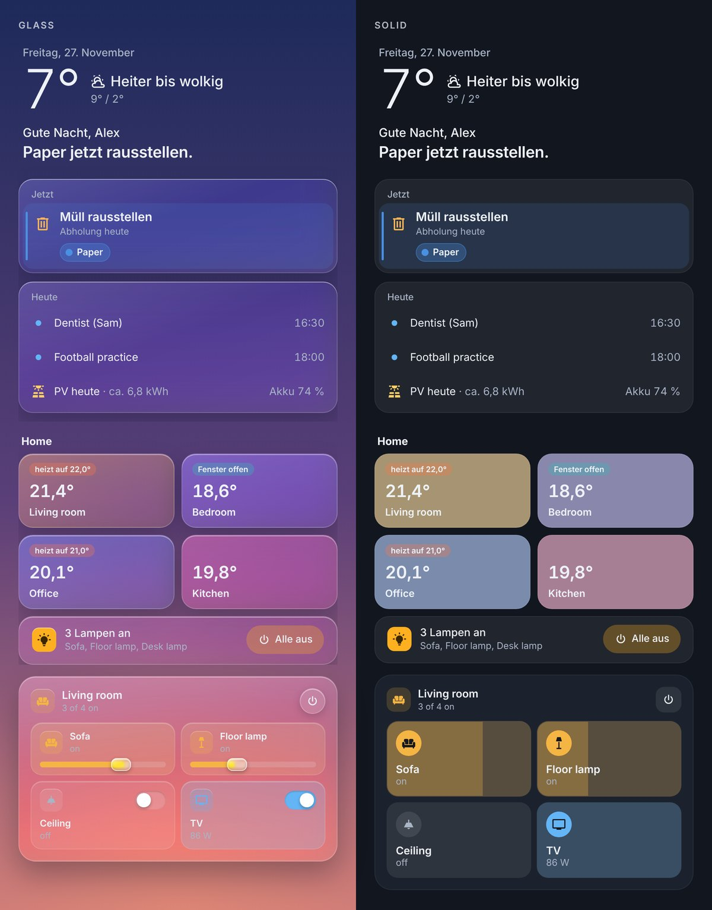

# Pane Cards

A family of Home Assistant cards that look like one: the same header, the same
tiles, the same state colours – in **glass** or **solid**, decided by your theme.
Every option is in the visual editor; YAML is only needed for templates.



> Work in progress. In the pack so far: **Pane Tile Card**, **Pane Today Card** and
> **Pane Rooms Card**. More (thermostat, weather, calendar, shopping list, chart,
> vacuum) move in one by one. Today and Rooms show German texts for now.

## Installation

**HACS:** add this repository as a custom repository (category *Dashboard*) and
install *Pane Cards*. The resource is added automatically.

Pair it with the [Pane theme](https://github.com/donsebby/pane-theme) (Pane Glass or
Pane Solid) – or set the variables below in your own theme.

## Pane Tile Card

One card, many rows. Each row is a **switch**, **bar**, **ring** or **number** for
one entity: lights (dim by dragging), switches, sensors, numbers, counters.

```yaml
type: custom:pane-tile-card
title: Living room
icon: mdi:sofa
header_action: all_off   # optional power button in the header
columns: 2               # 1 = list, 2-4 = grid
rows:
  - entity: light.dining_table
    type: bar
  - entity: switch.tv_plug
    power_entity: sensor.tv_plug_power
  - entity: sensor.washer_progress
    type: gauge
    color: ok
```

| Option | Values |
|---|---|
| `title`, `icon`, `icon_color` | header; `icon_color` like `color` below |
| `subtitle` | empty: automatic (“3 of 6 on”), `none`, text or template |
| `header_action` | `all_off` – turns off every light and switch of the card |
| `columns` | `1` (list) to `4` |
| `look` | `glass` or `solid`; without it the theme decides |
| `frame` | default: own panel, none inside a pop-up; `true` always, `false` never |
| `glow` | `false` – calmer, no glow on active tiles |
| `stat_size` | `large` – bigger numbers |

Per row: `entity`, `type` (`toggle`, `bar`, `gauge`, `stat`), `name`, `icon`,
`color`, `min`, `max`, `hide_track`, `power_entity`, `state_text`, `progress`,
`value`, `line`, `tap_action`, `hold_action`.

**Colours** mean state: `warm` (light, sun), `heat`, `accent`, `ok`, `alert`, any
Home Assistant colour name (`red`, `amber` …) or a CSS colour. Without one, lights
show their own colour and everything else the accent.

**Templates:** `name`, `icon`, `color`, `state_text`, `progress`, `value` and the
header fields accept `[[[ return … ]]]` with `states`, `hass`, `entity` and `fmt`
(formatted state) in scope.

Configs of the *Liquid Glass Tile Card v2* work unchanged (`type:
custom:liquid-glass-tile-card-v2` is accepted as long as the old card is not
installed).

## Pane Today Card

The start of the day in one card: date, weather, a short sentence about what
matters now, then calendar events, waste pickup, PV forecast, running appliances
and status rows. `view: running` shows only what is running right now,
`view: night` (“Haus für die Nacht”) shows open windows, lights that are on (with
an *off* button) and the waste pickup – or a calm “all closed” row.

```yaml
type: custom:pane-today-card
weather: weather.home
calendars:
  - entity: calendar.family
    color: '#64B5F6'
waste:
  entities:
    - entity: sensor.waste_paper   # attributes: YYYY-MM-DD pickup dates
      name: Paper
      color: '#4a90e2'
energy:
  pv_today: sensor.pv_today
  pv_tomorrow: sensor.pv_tomorrow
  battery: sensor.battery
```

Optional:

- `timeline: true` – during the day, today as a timeline with times: events that
  are not over yet (*jetzt* for the running one), sunset and the start of rain or
  snow from the hourly forecast. `max_timeline` (default 6) caps the rows.
- `outfit: true` – between 5 and 9 o'clock a first row with what to wear, from
  the day's high (plus an umbrella when rain is expected).
- `goodnight: { from, until, windows_label, lights_label, show_lights }` – the
  check before bed; in `view: today` only between `from` and `until`.

Most options are in the visual editor; bathroom, parcels, notices, warnings and
updates are YAML only for now.

## Pane Rooms Card

One tile per room with temperature, what the heating does, open windows and
playing media, plus a row with all lights that are on and an *all off* button.

```yaml
type: custom:pane-rooms-card
title: Home
tiles: true
lights_label: lights        # lights with this label count per area
rooms:
  - name: Living room
    area: living_room
    climate: climate.living_room
    media: [media_player.living_room]
  - name: Bedroom
    area: bedroom
    climate: climate.bedroom
    windows: [binary_sensor.bedroom_window]
    heating_status: sensor.bedroom_heating   # optional
```

`heating_status` takes a text sensor of your own heating control: a state like
`Manuell 22,0 °C bis 18:00` shows *Hand 22° bis 18:00*, a state starting with
`Fenster` shows *Fenster offen* (only when the room has no `windows`).

Configs of *today-glass-card* and *home-glass-card* work unchanged (the old type
names are accepted as long as the old cards are not installed).

## Theme variables

| Variable | Meaning |
|---|---|
| `pane-look` | `glass` or `solid` |
| `pane-glass` / `pane-surface` | card background in glass / solid |
| `pane-border`, `pane-blur`, `pane-backdrop`, `pane-radius`, `pane-tile` | edge, blur, corners, tiles |
| `pane-warm`, `pane-heat`, `pane-accent`, `pane-ok`, `pane-alert` | the five state colours |

## Changelog

### Unreleased
- Today: `timeline` (today with times, sunset, start of rain), `outfit` (what to wear in the morning), new `view: night` and the good-night options in the visual editor.
- Rooms: `heating_status` per room shows manual heating (“Hand 22° bis 18:00”) and open windows reported by the heating control.
- Tile: solid tiles take their edge, shadow and backdrop from the theme (`pane-tile-edge`, `pane-tile-shadow`, `pane-tile-backdrop`), so the calm solid tiles can also be made of glass.

### 0.2.0
- New: Pane Today Card (successor of today-glass-card) and Pane Rooms Card (successor of home-glass-card), both with glass and solid look and a visual editor.

### 0.1.1
- No panel of its own inside a pop-up (`frame` now defaults to automatic).

### 0.1.0
- First version: shared core (look from the theme, header, templates, actions,
  visual editor building blocks) and the Pane Tile Card.
